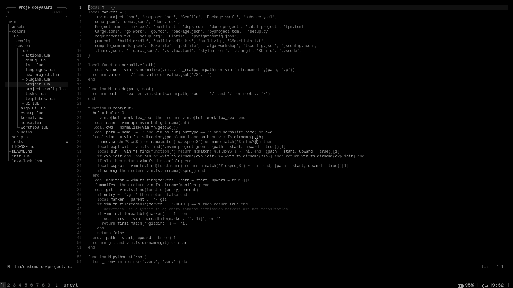

# nvim

My Neovim configuration for C, C++, C#, Go and systems work. LazyVim supplies the editor foundation; local Lua modules handle project roots, build tasks, debugging and navigation.



## Improvements

- Build, run and debug use the same project root, including nested projects.
- Native C/C++ tasks, CMake and Make projects, Cargo tasks and C# workflows share an output panel.
- Project templates include C++ and OpenGL scaffolding; kernel-module helpers detect local kernel build trees.
- Language servers are enabled when their executables are available. Project Python environments take precedence over unrelated inherited environments.
- Harpoon lists are scoped to the project; Oil handles directory edits and Snacks handles search.
- A quiet monochrome UI with text labels, compact status information and no dashboard.

## Use

Tested with Neovim 0.12.6 on Linux. Requires Git, a C toolchain, Python 3, ripgrep and fd; install the compilers, language servers and debug adapters for the languages you use. Clipboard integration on X11 needs xclip or xsel.

Back up your existing configuration, then place this repository at `~/.config/nvim`. Start `nvim`; the existing lazy.nvim bootstrap installs plugins. `lazy-lock.json` records plugin revisions; `:Lazy restore` restores them. No separate installation script is needed.

The leader is Space. Useful keys:

| Key | Action |
| --- | --- |
| `Space ff` / `Ctrl+p` | Find files |
| `Space /` | Search the project |
| `Space e` | File explorer |
| `F6` / `Space rr` | Build and run |
| `F7` | Project terminal |
| `F5` / `F9` | Debug / breakpoint |
| `F2` / `F4` | Rename / code action |
| `Space ba` / `Space bh` | Pin file / open pinned files |
| `-` | Edit directory with Oil |
| `Space ?` | Key reference |
| `Page Up` / `Page Down` | Scroll the viewport one line |
| `Alt+↑` / `Alt+↓` | Move the current line or selected block; also works in insert mode |
| `Ctrl+d` | Select the word; press again to add the next match |
| `Ctrl+c` | Copy the selection, or the current line when nothing is selected |
| `Ctrl+v` | Paste; replacing a selection preserves the clipboard |

For multiple matches, press `Ctrl+d` repeatedly, then `c`, type the replacement,
and press `Esc` twice to leave insert mode and clear the extra cursors.
Multiple selections use [multicursor.nvim](https://github.com/jake-stewart/multicursor.nvim).

Copy/paste in editor buffers uses `Ctrl+c` / `Ctrl+v`. Legacy `y/Y`, `p/P`,
`gp/gP`, `[p/]p/[P/]P`, `Space y/p`, `Ctrl+Insert`, `Shift+Insert`,
middle-click paste and insert/command-line register paste (`Ctrl+r`) are disabled.
Letters still type normally in insert mode. Deleting or changing text does not
overwrite the system clipboard. Terminal input keeps its own shortcuts,
including `Ctrl+c` to interrupt a running program.

`:IDEInfo` reports available language tools. Change project search directories in `lua/plugins/navigation.lua`. Some personal command labels and messages are in Turkish. Optional Exercism shortcuts expect exercises under `~/code/exercism`; account configuration is not included.

Tests under `tests/` cover roots, tasks, templates and editor interactions. For example, from this repository after putting it at your Neovim config path:

```sh
nvim --headless -u NONE -i NONE -l tests/ide.lua
```

Some integration tests require the plugins or their language toolchains.

## Credits

Started from [kickstart.nvim](https://github.com/nvim-lua/kickstart.nvim), now based on [LazyVim](https://github.com/LazyVim/LazyVim). Theme: [eyes.nvim](https://github.com/amedoeyes/eyes.nvim). Navigation is inspired by [ThePrimeagen/harpoon](https://github.com/ThePrimeagen/harpoon), [tjdevries/config.nvim](https://github.com/tjdevries/config.nvim) and [JakeAtLinux/nvim](https://github.com/JakeAtLinux/nvim), as recorded in the original configuration. The compact statusline takes cues from mini.statusline.

The inherited MIT license is preserved in `LICENSE.md`. Plugins retain their own licenses.
